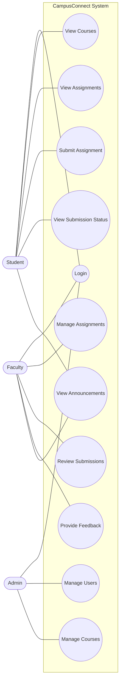

# CampusConnect - Use Case Diagram

## Actors
- Student
- Faculty
- Admin

## Use Case Diagram

## Description

The use-case diagram represents the interactions between three main actors and the CampusConnect system.

- Student: Views courses, checks assignments, submits work and tracks submission status.
- Faculty: Creates assignments, reviews submissions and provides feedback.
- Admin: Manages user accounts and course information.
